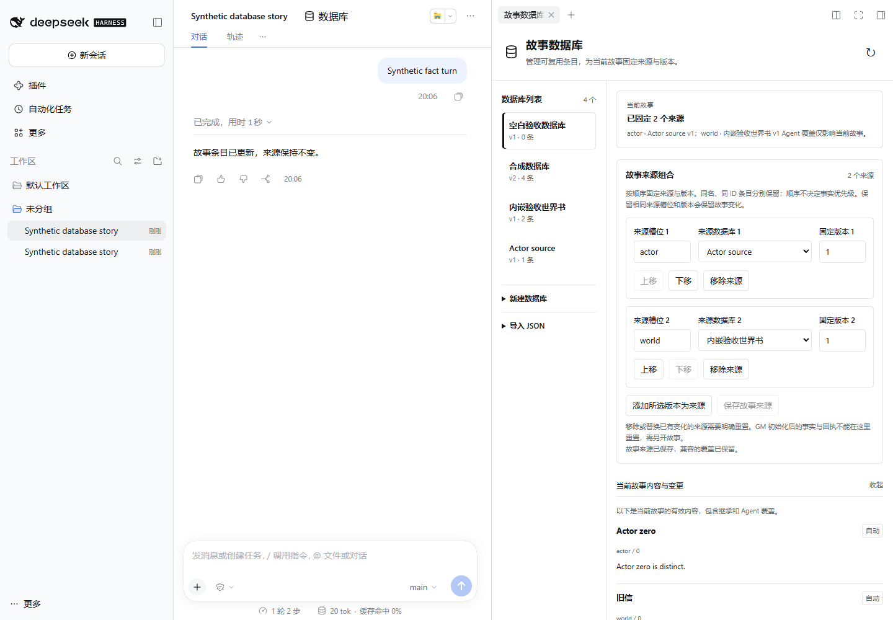

# DSH RP Database

原生 DSH 故事数据库插件，用可复用、可编辑的条目替代依附 Agent preset 的世界书。一个故事可按顺序固定多个来源版本；同 ID 条目按来源区分，Agent 只维护自己的故事覆盖，不写回原件或其他故事。GM 的事实提交与回执保存在同一个数据库事务中，材料准备阶段不能改写已注册事实。



## 安装

0.2.0 要求官方 DSH 0.2.1-rc.3 或后续受支持的 0.2.x，Node24。旧 0.1.1 在 rc.2 的历史验收仍保留；新版本不宣称已验过 rc.2。使用构建或正式 Release 的 `dsh-rp-database-0.2.0.tgz`，完全退出 DSH 后执行，再重启：

```powershell
dsh plugin --profile desktop add ./dsh-rp-database-0.2.0.tgz
```

Web 模式将 desktop 改为 web。点击会话顶部 **数据库** 或右侧新增页签中的 **故事数据库**。Windows 找不到 dsh 时可使用默认官方启动器：

```powershell
$dshCli = Join-Path $env:LOCALAPPDATA 'Programs/DeepSeek Harness/resources/runtime/cli/bin/dsh.cmd'
& $dshCli plugin --profile desktop add ./dsh-rp-database-0.2.0.tgz
```

## 使用

1. 导入 SillyTavern 世界书 JSON，或新建空白数据库并添加条目。原始导入文本独立保存，宏、脚本和未知扩展不执行。
2. 编辑正文、关键词、标签与叙事备注；设置 **Agent 只读** 及 **自动／必开／禁用**。
3. 保存源版本，再在 **故事来源组合** 添加来源、指定槽位和固定版本；可调整顺序。同 ID 不覆盖彼此，顺序只影响迭代与展示。
4. 保留相同槽位/数据库/版本可保留变化。移除或替换有变化的来源时，界面说明影响，并要求确认重置；GM 初始化后的事实与回执不能在这里丢弃，需另开故事。来源草稿和源条目草稿分别保留自己的 revision，冲突不会自动重放。
5. Agent 用目录、读取、搜索和补丁工具维护当前故事。目录返回程序生成的 entryKey；按 key 读取、修改具体来源。新条目进入当前故事的 @session 槽位。界面显示来源与条目 ID，可查看有效内容、变更与临时备注。

旧 **应用到当前故事** 是替换为单一来源的兼容操作；已有绑定时先确认重置影响。模型没有重新绑定、重置、人类策略或事实所有权参数。

只读与选材相互独立：只读条目仍可按需选择，必开条目不能从材料中移除，禁用条目不能经模型直接读取或搜索绕过。人类可以编辑锁定条目的源版本；Agent 不能改这些策略。

人物知情、误解、传闻和揭示条件写在自由文本 **叙事备注**，由 GM 判断；插件不建立 NPC 权限表。资料、提案和已确认事实的区别也应在备注中说明。GM 故事使用单独的事实阶段 facade 提交 gm.scene/gm.facts；普通补丁和材料准备不能修改其注册事实，但仍可编辑允许的工作资料。人类只读/禁用策略同样约束事实阶段。

分叉继承有效来源变化，回退后不再使用失效分支的覆盖；原始文本和变化记录仍保留供回溯。临时备注属于其创建的准备步骤，不自动变成永久世界事实。

## SillyTavern 导入范围

支持独立世界书 JSON 的 entries 映射、常见 ST 条目数组、标准 Character Book，以及角色卡 V2／V3 JSON 中的 character_book / data.character_book。只提取其中的世界书，不把角色系统指令、开场或其他角色字段冒充数据库条目；PNG/APNG 角色卡与压缩包尚未支持。

正文、标题、ID、关键词、启停和常驻条目会映射；常驻转为必开，禁用优先。源 displayIndex 用于稳定整理导入条目。源里的禁止覆盖标记不会自动变成人类设置的 Agent 锁。

正则、复杂宏、AND/NOT 激活条件、概率、递归、深度位置、粘滞/冷却和角色过滤只保留来源，导入报告明确列出，不执行或宣称复现。否定次级键不会转成正向检索词。报告随原件保存，重新打开仍能查看。

[完整字段映射与示例](docs/sillytavern-import.md) · [SillyTavern 功能对照](docs/sillytavern-comparison.md)。

## 检索与模型

关键词检索可以独立运行，支持 ID、标题、关键词、标签、中文分词与正文。可配置 OpenAI-compatible embedding 和 rerank 服务：

```yaml
- id: rp-database
  config:
    embedding:
      baseURL: http://127.0.0.1:8080/v1
      model: your-embedding-model
    reranking:
      baseURL: http://127.0.0.1:8081/v1
      model: your-rerank-model
```

将示例 URL/model 改成自己实际服务，通过 DSH 插件配置应用。远程服务可增加 apiKey，密钥不进入模型选材结果或浏览器状态。两个接口分别为 `/embeddings` 与 `/rerank`，不是聊天补全接口。未配置或失败时明确标记降级，不伪装成已经完成语义检索；模型不会自行指定外发地址。

检索产生候选而不替 GM 决定。配合 [RP Context](https://github.com/LiweiDonVee/dsh-rp-context)，中间模型能重新搜索整个启用库、读原候选之外的条目、修改允许的会话资料并排序选材。配合 [RP 最后一步](https://github.com/LiweiDonVee/dsh-rp-last-step)，正式正文消费冻结快照。

## 工具与服务

绑定会话获得 `rp_db_catalog`、`rp_db_read`、`rp_db_search`、`rp_db_patch`，工具只处理实际调用 Agent 的会话。工具保持 entryIds/operations[].id 字段，值使用目录给出的 entryKey；旧单来源 legacy 槽位可继续使用无歧义裸 ID。修改要求当前 revision；一个批次全部通过才提交。来源数据库 ID 和版本不由模型改动。

可选服务 `ctx.get('rpDatabase')` 的 apiVersion 为 2，新增 bindSources、effectiveV2/catalogV2/readV2/searchV2/patchV2、initializeStoryState、factAccess 和 materialAccess。typed v2 使用 `{sourceKey,entryId}`，材料 facade.version 为 2，planner 使用 entryKey。旧单来源服务保留，多来源调用须显式使用资格引用。[精确 API、事实回执和合成示例](docs/api-v2.md)。

## 数据与开发

本地事务文件位于 `$DSH_HOME/app-data/rp-database/state.json`；未设置 DSH_HOME 时使用 `~/.dsh`。备份或升级前退出 DSH。首次读取旧 schemaVersion 1 时原子迁移为 2，保留原件、固定版本、legacy 槽位和带 anchor 的变化，不压平分叉状态；旧 0.1.1 不读取 v2 文件。文件包含原始资料、会话变化与事实回执，不应当作公开调试附件。

开发需要 Node24、pnpm11.9：

```powershell
pnpm install --frozen-lockfile
pnpm check
pnpm package
```

产物与 SHA256SUMS 在 artifacts。`pnpm smoke` 单独安装本包到隔离 home，使用当前官方宿主、确定性本地模型和合成事实工具验证原生调用、阶段保护、回执与界面；不代表 GM/Context/Last Step 完整组合或真实推理质量。本文 0.2.0 是 Database 基础检查点；TXT/MD/PDF 与持久增量索引尚未实现。MIT 许可证。

[架构说明](docs/architecture.md) · [验收记录](docs/acceptance.md) · [更新记录](CHANGELOG.md)
